<picture>
  <source media="(prefers-color-scheme: dark)" srcset="./assets/header-dark.svg">
  
</picture>

 

I run **[Inno Source](https://innovationsrc.com)**, an ERP company in Cairo. I build the system, deploy it, and run the servers under it. The work sits between what a factory or a distributor needs on the ground and the code that has to deliver it.

بابني سيستم ERP مصري للمصانع والموزعين وشركات التجارة، من أول سطر كود لحد السيرفر اللي شغال عليه.

## Flagship: Inno Source ERP

**[innovationsrc.com](https://innovationsrc.com)** · my biggest project and the one everything else orbits.

A multi-tenant ERP for factories, distributors and trading companies, live with manufacturing clients and sold in Egypt, Saudi Arabia and the UAE. Arabic-first and RTL throughout, available as SaaS or on-premises.

- **Manufacturing** with production-line tracking, down to excise-stamp tracking for export manufacturers
- **Van Sales**, a native Android app for field reps: offline queueing, multi-unit invoicing, customer visits, end-of-day settlement
- **CRM** with phone-system (PBX) integration
- **AI add-ons**: computer vision and an Arabic AI assistant
- **Custom modules on request**, from schools to anything that needs wiring into existing devices, payment methods or third-party systems
- Updates shipped daily, with 24/7 support behind them

## More projects

| Project | What it is | Stack | Status |
|---|---|---|---|
| **Inno OPS** | Control panel for OPNsense firewalls: per-user and per-device blocking, VPN access groups, and a discovery tool that finds what a system needs allowed | Django | Building |
| **InnoForge** | Open-source platform that builds a management app and its database from a prompt, then hands you full manual control | — | Early development |
| **عَنّي (3ni)** | Digital profile pages with NFC cards, for people, company teams, shops and restaurants | Django, DRF, Nuxt 3 | Building |
| **Kallemny (كلّمني)** | Voice English coach with an animated character and scenario-based practice, backed by an AI model | Nuxt 3 | Building |
| **Phone Bridge** | Links a phone to a Windows, Linux or Mac computer: answer calls, talk and listen from the desktop, keep call history | — | Building |
| **Live Presenter** | Builds a slide deck live from what you say in a meeting, in Arabic or English | Nuxt 3, Claude API | Building |
| **Driver app** | On-demand vetted drivers who drive your own car, for Egypt | — | Planned |

## What I do

- **ERP and business systems.** Data models, accounting-grade workflows, multi-tenancy, and turning how a business really runs into software.
- **Backend and APIs.** Python, Django and Django REST Framework, with Celery for background work.
- **Frontend.** Vue 3 and Nuxt 3 with Vuetify, Pinia, Tailwind and i18n. Arabic RTL is a first-class citizen, not an afterthought.
- **Mobile.** Android apps that keep working offline and sync when they can.
- **AI integration.** LLM assistants and vision features built into real products.
- **Infrastructure.** Linux servers, Nginx, Proxmox, TLS and deployments that I run myself.
- **Networking.** Enterprise network design: VLAN segmentation, OPNsense, WireGuard, Cloudflare Tunnel, multi-WAN.

## Stack

**Backend**&nbsp;&nbsp;

**Frontend**&nbsp;&nbsp;

**Mobile**&nbsp;&nbsp;

**Infra and networking**&nbsp;&nbsp;

**Earlier in the road**&nbsp;&nbsp;

## The road here

| | |
|---|---|
| **2017** | Started in the open with PHP and JavaScript: [auth systems with PDO](https://github.com/GeekAhmeds/Sign-Up-And-Login-Form-Using-PDO), a [products manager](https://github.com/GeekAhmeds/PRODUCTS-MANAGEMENT), and [30 days of HackerRank](https://github.com/GeekAhmeds/HackerRank-30-Days-Of-Codes). |
| **2018–2019** | Moved to Python and Django with a [social network](https://github.com/GeekAhmeds/Website-Social-Media-Using-Django), and played with computer vision and ML in [OpenCV](https://github.com/GeekAhmeds/Invisibility-Cloak-using-Color-Detection-and-Segmentation-with-OpenCV) and [ml5.js](https://github.com/GeekAhmeds/ML5js). |
| **2021–2022** | Went deep on business software: Odoo modules for [hospitals](https://github.com/GeekAhmeds/3c_hospital_odoo), [reporting](https://github.com/GeekAhmeds/3c_inherit_report) and [point of sale](https://github.com/GeekAhmeds/Change-Product-Item-Design-POS). |
| **2022–2023** | Frontend years: [Vue e-commerce](https://github.com/GeekAhmeds/ecom_vue) and React. |
| **Now** | Building my own ERP instead of customizing someone else's, plus the projects above. |

## Off the clock

Usually still at a keyboard: side apps on Android, and reverse engineering with Ghidra.

## Commits, eaten

<picture>
  <source media="(prefers-color-scheme: dark)" srcset="https://raw.githubusercontent.com/GeekAhmeds/geekahmeds/output/snake-dark.svg">
  
</picture>

  <a href="https://innovationsrc.com">innovationsrc.com</a>

